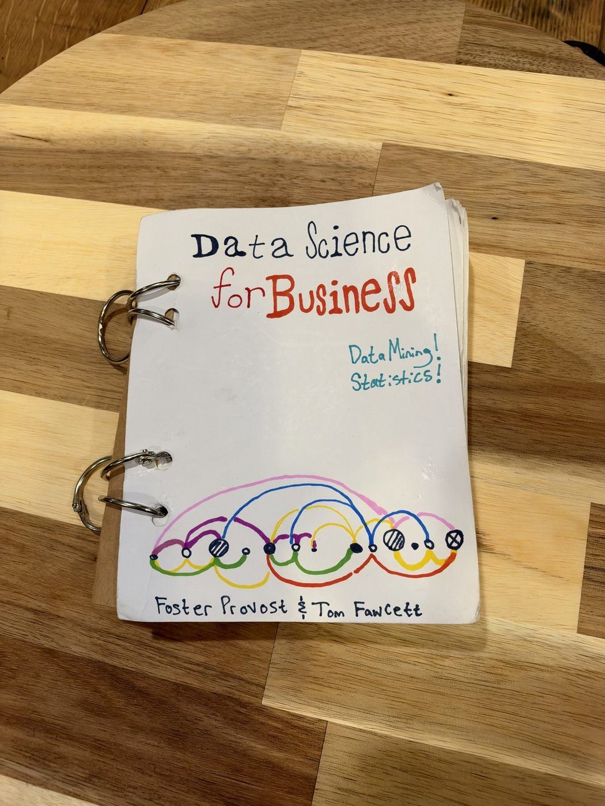
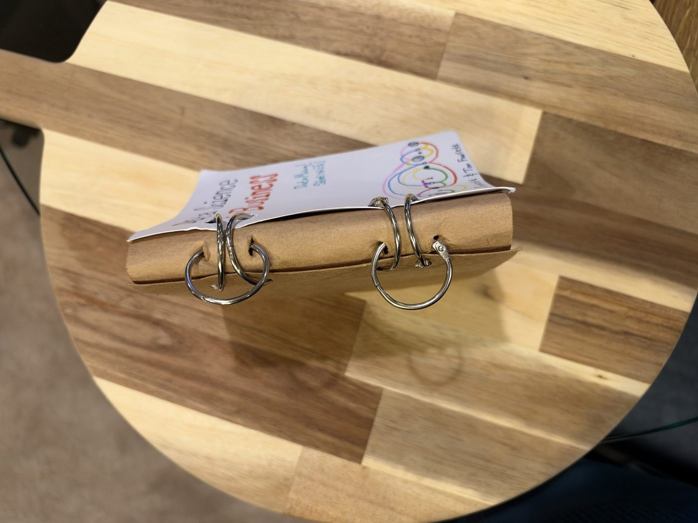
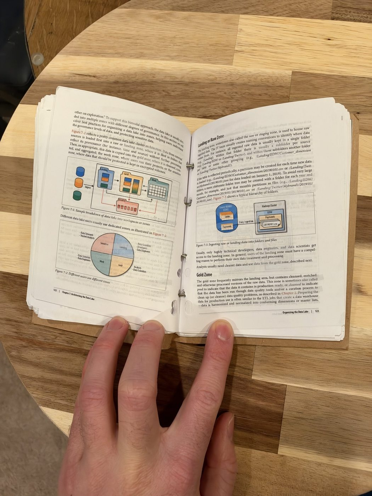

# MiniBook Maker

**From digital PDF to physical mini-book.**

MiniBook Maker is a native macOS application that converts PDF documents into printable, ring-bound mini-books. It combines PDF processing, automated duplex page imposition, and mathematical binding geometry to simplify the physical assembly process.

**Version:** 2.1 · **Platform:** macOS 12 or later (declared target) · **Language:** Swift

## Physical output

<table><tr><td width="50%"></td><td width="50%"></td></tr></table>

The original photographs document actual printed and ring-bound examples. They illustrate the physical workflow, not a controlled verification of print accuracy.

[Photograph collection](assets/photographs/README.md) · [Application screenshots](assets/screenshots/README.md) · [Portfolio case study](https://mjscarpello.github.io/Portfolio-Repository/personal/mini-bookmaker.html)

## Highlights

- Import PDFs, interpret full pages or two-page spreads, and select and arrange the reading order.
- Produce 4.25 × 5.5-inch pages, four per side of a US Letter sheet.
- Arrange up to 64 logical pages in each eight-sheet cutting batch, with automatic handling of partial batches.
- Calculate adaptive punch guides for individual leaves using ring diameter and estimated or measured stack thickness.
- Preview and export PDFs, including a numbered calibration sheet set and the first cutting batch.
- Validate page order and binding geometry before building the application.

## How it works

`Import PDF → Select & arrange → Pair pages → Calculate punch guides → Impose sheets → Export → Print, cut & bind`

### Cut-stack imposition

Instead of printing consecutive pages on each sheet and sorting them individually, the algorithm distributes pages across four contiguous piles. For the first sheet in a full 64-page batch:

| Front left | Front right | Back left | Back right |
|---|---|---|---|
| 1 | 17 | 18 | 2 |
| 33 | 49 | 50 | 34 |

Print all eight sheets in portrait, two-sided, **flip on long edge**, at **100% / actual size**. Keep the sheets aligned and cut the stack vertically and horizontally. Stack the four piles in this order:

| A: Top left | B: Top right | C: Bottom left | D: Bottom right |
|---|---|---|---|
| 1–16 | 17–32 | 33–48 | 49–64 |

The algorithm recalculates pile sizes for shorter final batches. Reading order and physical print order are separate operations.

### Adaptive binding geometry

The application calculates hole-pair spacing using the circular chord relationship:

**s = 2 × √(r² − d²)**

where *r* is the ring radius and *d* is the leaf's depth relative to the center of the stack. Front and back guides mirror horizontally to align with the same physical holes after long-edge duplex printing.

For a 200-page book (100 leaves), a 1-inch ring and estimated 0.004-inch paper caliper produce approximately 0.918-inch spacing at the first and last leaves and 1.000-inch spacing at the middle. Incompatible ring/stack geometry is rejected before export.

See [the original technical notes](docs/VERSION_2_1_TECHNICAL_NOTES.md) for the complete page-order contract, guide defaults and calibration procedure.

## Build and run

Requirements: a Mac and Swift 5.9 or newer, available through Xcode or compatible Apple command-line tools. Native compilation requires Apple's AppKit and PDFKit frameworks.

From the extracted source folder, open Terminal and run:

```bash
chmod +x "Build MiniBook Maker.command"
./"Build MiniBook Maker.command"
```

Review the script first. It runs regression tests, builds the application, packages it, replaces any existing `~/Applications/MiniBook Maker 2.app`, and opens the installed copy. The original [start guide](START%20HERE.txt) contains more details.

For a first print, use **Export → Export 64-Page Cut-Stack Calibration…** and check the four piles before printing a complete book. Printer alignment and physical fit should be verified on actual hardware.

## Testing

The original regression suite checks exact 64-page ordering, partial batches, page uniqueness and duplex pairing for every page count from 1 through 513, and adaptive ring geometry. It can be run separately:

```bash
swiftc Sources/MiniBookMaker/ImpositionPlan.swift \
  Sources/MiniBookMaker/BindingGeometry.swift Tests/main.swift \
  -o /tmp/minibook-self-test
/tmp/minibook-self-test
```

The pure-Swift suite was rerun successfully during repository preparation. See [verification notes](docs/REPOSITORY_VERIFICATION.md) and [original test results](docs/ORIGINAL_TEST_RESULTS.txt). The macOS GUI and physical printing were not retested during repository preparation.

## Source organization

| Path | Purpose |
|---|---|
| `Sources/MiniBookMaker/` | SwiftUI interface, application state, PDF operations and mathematical logic |
| `Tests/main.swift` | Standalone regression suite |
| `Resources/Info.plist` | Application bundle metadata |
| `Package.swift` | Swift package configuration |
| `docs/` | Original technical notes and verification records |
| `assets/` | Location for authentic screenshots and physical output photographs |
| `examples/` | Location for shareable input/output examples |

## Project development

Version 2.1 introduced cut-stack manufacturing and adaptive punch guides. This repository preserves the recovered source version without committing local build caches or generated application binaries. See [release notes](docs/RELEASE_NOTES.md).
